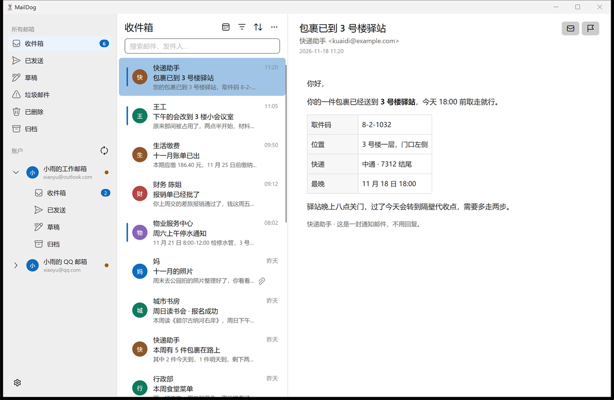
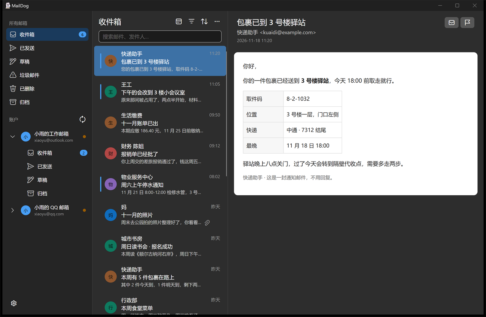

# MailDog

Windows 和 Linux 上把 QQ 邮箱和 Outlook 收进同一个窗口的桌面邮件客户端。看过的信存在本机，断网也能翻；关掉窗口，后台照样收信。

[下载](https://github.com/refout/MailDog/releases/latest) · [官网](https://refout.github.io/MailDog/) · [更新日志](https://refout.github.io/MailDog/changelog.html)



> 截图取自 v0.1.1 的实机运行窗口，里面的邮件是演示数据，不是谁的收件箱。

<details>
<summary>暗色主题和设置页的样子</summary>




</details>

## 现在能做什么

发布版 **v0.3.4** 修好 CLI 对 HTML-only 邮件的读取：`show` 在纯文本缺失时自动把 HTML 转成可读文本，需要原样内容时加 `--html`；`--json` 增加 `textSource` 和可选的 `html` 字段。CLI 调用记录升级为 `logs/cli-calls.jsonl`，带 `--json` 的调用会保留当时输出，设置 → 工具里可以直接查看。**v0.3.3** 把 CLI 下载改成下载后自动解压到软件安装目录，解压成功即删除压缩包，失败时保留压缩包供重试。**v0.3.2** 收口更新与 CLI 的三件小事：更新包装完后立即删除、启动时再补删旧包；CLI 下载后可以一键复制路径说明给智能体；CLI 每次调用只记命令名、退出码和耗时，不碰参数与邮件内容。**v0.3.1** 修正 CLI 下载位置：入口从关于页移到设置「工具」，压缩包直接保存到软件安装目录。**v0.3.0** 把 Linux（x64）补齐：Engine、UI 与命令行都能在 Linux 上编译运行，数据目录遵循 XDG，登录启动写入 `~/.config/autostart`，凭据优先交给系统钥匙串、没有 Secret Service 时回退本机密钥的 AES-GCM。Linux 现在用 WebKitGTK 渲染 HTML 正文，缺库时自动退回纯文本；桌面环境提供 StatusNotifier 托盘宿主时显示托盘图标，没有时仍可用关于页“退出后台”；`maildog://` 协议把通知点击和第二次启动交回已运行的实例，锁屏时通知只留一句“有新邮件”，检查更新能识别 `linux-x64.tar.gz`。账号健康面板、脱敏诊断包和 UI 崩溃留痕也进了这一版；Windows 侧补上 `mailto:`、`.eml` 打开方式、默认应用候选、“发送到”和最近邮件；命令行改为按需下载，不再随安装包展开。v0.2.5 给「检查更新」补上就地状态：点击后在版本号下方显示检查中、已是最新、发现新版本或失败原因；检查更新、下载更新和打开项目主页都改成文字链接。v0.2.4 把「关于」页里多余的更新区整块去掉，只保留版本号旁的「检查更新」按钮；v0.2.3 收敛了设置页重复的版本号、分区标题和说明，统一主窗口三栏的上下左右边距，并真正修复自动升级装完后不自动重新打开的问题。包仍然直接从 `main` 打。

- **两个邮箱，一个窗口**：QQ 邮箱用授权码登录，Outlook 点一下用浏览器登录，不用填密码。两个邮箱的信在同一份列表里，收件箱、已发送、草稿、存档按邮箱分开列，哪个邮箱有几封没读，名字旁边直接标着。
- **写信闭环**：新写、回复、全部回复、转发；正文只保留原生富文本编辑器（AvaloniaRichEditor），工具栏支持 H1/H2/H3/正文、加粗、斜体、下划线、删除线、项目符号、编号、引用、链接、插入图片与撤销重做；底栏固定「附件」入口，可添加/移除本机附件，单封合计不超过 25 MiB，附件较多时自动换行；设置里可配置邮件签名，新写、回复和转发时自动插到正文下方；草稿可续写并同步到 Drafts；发送成功后按设置保存到已发送。富文本邮件同时生成纯文本回退，出站 HTML 先清洗再交给 SMTP。
- **发件箱可见**：待发送、发送中、失败状态和尝试次数都能看到，失败可手动重试或删除；SMTP 失败按 1/2/5/10/30/60 分钟退避，最多 8 次。
- **邮件管理**：阅读区支持归档、移动到文件夹、删除；文件夹树支持新建、重命名、删除；批量标已读未读、加旗标。
- **找得到旧信**：主题、发件人、预览即时匹配，正文走 SQLite FTS5；图片附件可在阅读区内嵌预览，其他附件下载或用默认程序打开。
- **列表像桌面客户端**：鼠标悬停行右侧出现归档/切换已读/删除；紧凑档两行、标准档三行；主题里的搜索命中词直接高亮；搜索范围可在「当前文件夹 / 全部邮箱」之间切换。
- **同一会话收在一起**：按 `References`/`In-Reply-To` 或规范化主题折叠，行尾显示会话封数，阅读页「会话 N 封」可翻看同会话较早邮件。
- **写信收件人更好填**：To/Cc/Bcc 用 chip 管理，输入时从历史联系人补全，分号、逗号或 Enter 都能提交；发送、草稿和判空都以 chip 为准。
- **本地数据自己管**：设置页能看数据库、日志、附件缓存、发件箱占用并清理；支持创建 ZIP 备份、从备份恢复（下次启动生效）和把单封邮件导出为 `.eml`。
- **账户可维护**：编辑、删除、上移/下移、设为默认发信账户；Outlook 账户可重新授权。
- **新邮件马上提醒**：信到了就弹桌面通知，点一下跳到那封；同一批好几封会合并成一条“收到 N 封新邮件”，免打扰时段与锁屏时只留一句“有新邮件”，订阅文件夹不打扰。连接断了会自己重连，笔记本合盖再打开会补一次同步。
- **来信规则**：设置页「同步」区可按发件人、主题或两者加关键词（包含匹配，忽略大小写），新邮件一到就自动标已读、加旗标或不弹通知；可限定到某个邮箱，命中次数直接显示，规则写得太宽一眼能看出。只对之后收到的邮件生效。
- **发信前提醒、发信后能后悔**：正文提到附件却没带、单附件超 25 MiB、合计超 40 MiB 时先提醒，确认后才发送；默认留 10 秒撤销窗口（可设 0/5/10/30 秒），这段时间邮件停在发件箱，点撤回不会真的发出去。
- **自己检查更新**：关于页与托盘菜单都能检查 GitHub 上的新版本，下载后校验 SHA-256 再静默升级并重启；便携版只提示去下载页。
- **命令行 `maildog`**：`accounts` / `folders` / `list` / `search` / `show` / `attachment` 只读查询，`draft` / `send` / `mark` / `move` 写操作默认只预览，加 `--confirm` 才执行；`show` 对 HTML-only 邮件会自动转成可读文本，加 `--html` 看原始 HTML；`maildog schema --json` 供脚本和助手自描述，Engine 没开时会自动拉起。CLI 不预装，在设置 → 工具 → 命令行工具里下载，下载后自动解压到安装目录，并同时带 `maildog-cli` Skill；解压成功后可点「复制给智能体」把路径说明复制走，也可以在「查看调用记录」里回看带 `--json` 的调用结果。
- **看过的信存在本机**：邮件头、正文都存进本地的 SQLite，断网、邮箱服务器抽风时照样能翻能搜。
- **陌生邮件的排版动不了你的窗口**：HTML 正文只保留安全的那部分，远程图片默认不加载，某封信格式坏了就退回纯文字。
- **关掉窗口也能收信**：Windows 下右下角托盘的小图标一直看着邮箱，未读数是图标上的红点；Linux 下 Engine 无窗口常驻，界面关掉后继续同步，要停后台用关于页“退出后台”，或下载 CLI 后运行 `maildog quit`。
- **开机就能接着收**：设置页“启动”可以开关登录系统时自动启动；Windows 写入当前用户启动项，Linux 写入 `~/.config/autostart`，关闭后移除，不影响账户和邮件数据。
- **只专注邮件**：日历、联系人、待办、记事本模块已移除，左侧只保留账户、文件夹与设置，界面始终停留在邮件列表和阅读区。
- **发信前先看一眼附件**：正文里写了“见附件”却没带文件，或者附件太大时，发送前会拦一下让你确认，不会硬拦。
- **发出去还能反悔**：默认留 10 秒撤销窗口，信先停在发件箱，这段时间点「撤回」就不会真的发出去；设置页可改成 0/5/10/30 秒。
- **下载就能跑**：两个 Native AOT 单文件（Engine 与 UI），不用先装 .NET 运行时，不用另装数据库，也没有要注册的账号。UI 约 51 MB，后台进程约 17 MB；CLI 仍按需下载，安装包本身不带 CLI。
- **脚本和助手也能用**：设置 → 工具 → 命令行工具可下载 CLI + Skill 压缩包，下载后自动解压到安装目录，解压成功后可一键复制路径说明给智能体；查账号、列文件夹、搜信、读信、存附件；写信、发送、标已读、移动也支持，但默认只打印预览，加 `--confirm` 才真的动。`--json` 适合自己的脚本，`maildog schema` 让助手自己发现有哪些能力。

## 下载

| 文件 | 说明 |
|---|---|
| `MailDog-0.3.4-win-x64-setup.exe` | Windows 安装包，装完桌面有快捷方式 |
| `MailDog-0.3.4-win-x64.zip` | Windows 64 位便携版，解压双击 `MailDog.UI.exe` |
| `MailDog-0.3.4-win-arm64.zip` | Windows Arm 版便携包 |
| `MailDog-0.3.4-linux-x64.tar.gz` | Linux x64 包，解压后运行 `MailDog.UI` |

都在 [Releases](https://github.com/refout/MailDog/releases/latest) 里。Windows 要求 Windows 10 1809+ 或 Windows 11；Windows 10 需要先有 [WebView2 Runtime](https://developer.microsoft.com/microsoft-edge/webview2/)（Windows 11 已内置）。Linux 目前提供 x64 包，需要 glibc 与 X11/Wayland 桌面，通知依赖 `notify-send`（`libnotify-bin`）；想点击通知跳回邮件需要 `notify-send` 0.8+ 与支持 action 的通知守护进程，0.7 及更早版本只弹通知。

Linux 版现阶段的能力边界：托盘图标依赖桌面环境的 StatusNotifier 宿主（KDE 自带，GNOME 默认要装扩展），看不到图标时关掉界面 Engine 仍继续后台收信；要停止请用关于页的“退出后台”，或下载 CLI 后运行 `maildog quit`（不要直接 `kill -9`，否则发件箱和 WAL 可能来不及收尾）；HTML 正文走 WebKitGTK 4.1，系统没装 `libwebkit2gtk-4.1-0` 时自动退回纯文本；通知点击依赖 `notify-send` 0.8+ 的 action 支持；锁屏判断通过 `gdbus` 查询 GNOME/KDE 屏保，查不到时按未锁屏处理；新库凭据优先存进 `secret-tool` 管理的系统钥匙串，检测不到 Secret Service 时回退到数据目录内 0600 权限的随机密钥；旧版本已经生成的密钥文件会继续沿用，避免已有账户失效。

- **QQ 邮箱**：在 QQ 邮箱网页端开启 IMAP/SMTP，生成**授权码**（不是登录密码）填进去。
- **Outlook**：点“使用浏览器登录”，应用已内置 Entra 公共客户端（公共客户端 ID 不属于机密）。想换成自己注册的应用，设环境变量 `MAILDOG_ENTRA_CLIENT_ID`。
- **更新**：关于页与托盘里有「检查更新」，安装版可一键下载、校验 SHA-256 后静默升级并自动重启；便携版只提示去下载页换包。更新包暂存在 `%LOCALAPPDATA%\MailDog\updates`，安装完成或下次启动自动删除旧包。
- **数据放哪**：Windows 在 `%LOCALAPPDATA%\MailDog\`，Linux 在 `~/.local/share/MailDog/`；数据库、日志、附件缓存和原生库都在这里，备份、恢复与清理只看这个目录。

## 命令行

CLI 不随安装包展开。打开 **设置 → 工具 → 命令行工具**，点“下载 CLI + Skill”，会下载压缩包并自动解压到软件安装目录；解压成功后压缩包删除，失败时保留压缩包供重试：

- Windows：包内含 `MailDog.Cli.exe`、`maildog.cmd` 与 `maildog-cli/SKILL.md`
- Linux：包内含 `MailDog.Cli`、`maildog` 与 `maildog-cli/SKILL.md`，并补上执行权限

下载完成后，工具页会出现「复制给智能体」按钮：它把安装目录、需要时的压缩包路径、解压后的 CLI/启动脚本/Skill 路径，以及“读命令可直接执行、写命令先 dry-run”的约束一起复制到剪贴板，粘贴给外部智能体即可使用。

下载后的文件就在安装目录根下，把安装目录加进 PATH 后直接敲 `maildog`：

```powershell
maildog accounts
maildog list --folder inbox --limit 10 --unread
maildog search 发票 --json
maildog show 35211 --max-chars 0
maildog attachment 35211 1 --out D:\tmp
maildog send --account me@example.com --to you@example.com --subject "周报" --text "见附件" --attach D:\周报.pdf
```

不会自动修改 PATH，也不会写系统目录；卸载 MailDog 不会删除你解压出来的 CLI。写命令（`draft` / `send` / `mark` / `move` / `cancel`）默认只打印预览，确认无误再加 `--confirm` 才真正执行；Linux 无托盘时用 `maildog quit` 让后台正常退出；`send` 会返回撤销窗口，用 `maildog cancel <outboxId>` 撤回；`send` 发送前会查附件，命中提醒时退出码 `6`，确认后加 `--force-send` 强发。`maildog schema` 输出全部命令、开关、输出字段与退出码的 JSON。命令都通过命名管道交给后台 Engine，自己不碰数据库；Engine 没开着会自动拉起来。

CLI 每次调用会往数据目录的 `logs/cli-usage.log` 追加一行：时间、版本、命令名、退出码、耗时；不记参数值、邮箱、主题、正文或令牌。单文件超过 512 KB 时轮转为 `cli-usage.log.1`；设 `MAILDOG_NO_CLI_AUDIT=1` 可关闭。

## 版本变化

v0.1.0 是只读版（能加邮箱、收信、看信）。v0.1.1 加了关窗后仍收信、托盘与统一收件箱。v0.1.2 补齐写操作并换了新图标与新通知。v0.2.0 把日常摩擦收掉：通知合并/免打扰/锁屏隐私、应用内检查更新、本地来信规则、附件防漏提醒、延迟发送与撤销窗口，并加入命令行 `maildog`。v0.2.1 首次重做关于页，开源许可可折叠，检查更新移到版本号旁边。v0.2.2 尝试修复自动升级后不自动打开，但安装器的重启参数未生效。v0.2.3 清掉设置页重复说明、统一主窗口三栏边距，并由安装器在静默升级完成后显式拉起新版本。v0.2.4 去掉关于页的「更新」区，只留版本号旁的检查更新按钮。v0.2.5 给检查更新补上就地状态，把检查和项目主页入口改成文字链接。v0.3.0 补齐 Linux 桌面、诊断包、账号健康、CLI 按需分发与 Windows 系统入口；v0.3.1 把 CLI 下载移到设置「工具」并直接保存到安装目录；v0.3.2 在安装后清理更新包，给 CLI 加「复制给智能体」，并保留最小调用记录；v0.3.3 把 CLI 下载改成下载后自动解压，解压成功即删除压缩包；v0.3.4 让 CLI 读到 HTML-only 正文，并把带 `--json` 的调用结果留成 JSON 记录、可在设置「工具」里查看。逐版细节见 [web/changelog.html](web/changelog.html)。

## 开发

### 环境

- .NET SDK 11（锁定 `11.0.100`，见 `src/global.json`）
- Windows：Visual Studio Build Tools 2026，勾选 `Microsoft.VisualStudio.Component.VC.Tools.x86.x64` 与 `Microsoft.VisualStudio.Component.Windows11SDK.26100`
- Linux：`clang`、`zlib1g-dev` 以及 X11/Wayland 桌面运行库（Ubuntu 22.04+ 验证）

### 构建与测试

```bash
# global.json 在 src 下
cd src
dotnet build MailDog.slnx -c Release
dotnet test MailDog.slnx -c Debug --no-restore
```

### 发布与打包

Windows：

```powershell
# 发布 Engine / UI / CLI 三个 AOT 单文件（在仓库根执行）
pwsh -File src/build/publish.ps1 -Runtime win-x64

# 版本化压缩包：dist/MailDog-<版本>-win-x64.zip
pwsh -File src/build/package.ps1 -Runtime win-x64

# 打包 + 安装包（需要 Inno Setup 6，可 choco install innosetup）
pwsh -File src/build/package.ps1 -Runtime win-x64 -Installer
```

Linux：

```bash
# 产物：dist/MailDog-<版本>-linux-x64.tar.gz
./src/build/package-linux.sh linux-x64
```

版本号默认读 `src/Directory.Build.props`，可用 `-Version 1.2.3` 覆盖。推 `v*` 标签会触发 [release 流水线](.github/workflows/release.yml)，构建 win-x64 / win-arm64 压缩包、x64 安装包与 linux-x64 tar.gz 并创建 Release。

### 运行

```bash
# Windows：先起后台，托盘常驻，需要时再打开界面
dist/win-x64/MailDog/MailDog.Engine.exe

# 或者直接开界面（Engine 没跑会自动拉起，两个 exe 必须在同一目录）
dist/win-x64/MailDog/MailDog.UI.exe

# Linux：解压后直接开界面，Engine 会在同目录自动拉起
./MailDog.UI
```

Engine 支持 `--db <路径>` 换库、`--console` 附着终端输出、`--probe` 自检。界面通过 `MAILDOG_ENGINE_PATH` 找后台，后台通过 `MAILDOG_UI_PATH` 拉起界面。

## 技术构成

- **Engine**：MailKit（IMAP）+ SQLite 索引 + Windows Win32 托盘 / Linux 无托盘常驻 + OAuth2 PKCE + 命名管道服务，按需拉起 UI，UI 关闭后继续驻留；Linux 收到 `shutdown` IPC 后正常收尾退出。
- **UI**：Avalonia 12 + Fluent Design + Windows 上 NativeWebView 渲染 HTML、Linux 上纯文本阅读，关窗即退。

| 维度 | 决策 |
|---|---|
| 目标框架 | .NET 11；Engine 为 `net11.0-windows10.0.19041.0`（通知要用 WinRT 投影），其余为 `net11.0` |
| UI | Avalonia 12.1.6 + `Avalonia.Themes.Fluent` |
| 富文本编辑器 | `AvaloniaRichEditor` 1.3.0（MIT，纯 C#，HTML 导入/导出；无 WebView/TipTap 依赖） |
| WebView | `Avalonia.Controls.WebView` 12.1.2（Windows 用 WebView2），只用于读信 |
| 邮件 | MailKit 5.0.0，不引用 `MimeKit.Cryptography` |
| 存储 | SQLite（`Microsoft.Data.Sqlite`），ADO.NET |
| 认证 | QQ 授权码；Outlook OAuth2 Authorization Code + PKCE（Engine 内自研回环） |
| IPC | 命名管道 + 4 字节长度前缀 + 源生成 JSON |
| 发布 | Native AOT 单文件 × 3（Engine / UI / CLI），CLI 打进 `cli` 压缩包按需下载，无 .NET 运行时依赖 |
| 平台 | 目前只做 Windows；macOS / Linux 预留抽象 |

## 文档

- [技术方案](docs/PLAN.md)：架构、库选型、IPC 协议、存储、认证、AOT 纪律、里程碑、风险
- [界面设计](docs/UI-DESIGN.md)：Fluent 设计令牌、三栏布局、组件规格、交互与可访问性
- [探针结论](docs/SPIKES.md)：AOT、原生库嵌入、WebView2 与工具链实测记录
- [官网源码](web/)：`index.html` + `assets/site.css`，纯静态，没有构建步骤，Pages 直接发布这个目录

## 仓库结构

```
MailDog/
├── docs/               方案、界面设计、探针结论
├── src/                代码根：MailDog.slnx、global.json、项目、tests、build 脚本
├── web/                官网页面（GitHub Pages 的发布目录）
├── .github/            CI 与 release 工作流
├── .editorconfig
└── README.md
```

## 交付产物

本机构建出来的东西在 `dist/`：

```text
dist/
├── win-x64/
│   ├── MailDog/
│   │   ├── MailDog.Engine.exe
│   │   ├── MailDog.UI.exe
│   │   └── MailDog.Cli.exe
│   └── MailDog-<版本>-win-x64.zip
├── linux-x64/
│   ├── MailDog/
│   │   ├── MailDog.Engine
│   │   ├── MailDog.UI
│   │   ├── MailDog.Cli
│   │   ├── libSkiaSharp.so
│   │   ├── libHarfBuzzSharp.so
│   │   └── maildog
│   └── MailDog-<版本>-linux-x64.tar.gz
└── MailDog-<版本>-win-x64-setup.exe
```

正式发布的 v0.2.5 在 Release 里：x64 便携包 32.6 MiB、arm64 便携包 31.2 MiB、x64 安装包 23.5 MiB；安装包 SHA-256 `b1849b52e755ede0445c72902e027034c931986904c917a03f52c0856fdd8a74`。

- 三个可执行文件都是自包含单文件，不需要 .NET 运行时；UI 必须和 Engine 在同一目录才能自动拉起后台。
- Windows 的 SQLite / Skia / HarfBuzz / ANGLE 原生库嵌在 exe 里，首次启动解到 `%LOCALAPPDATA%\MailDog\native\`；Linux 的 `libSkiaSharp.so`、`libHarfBuzzSharp.so` 随包放在可执行文件旁边，SQLite 仍在首次启动解到数据目录。
- Windows UI 优先用 ANGLE 渲染，这样云母 / 亚克力材质和透明窗口才生效；加载失败自动回退 Skia 软件渲染。WebView2 有自己的 GPU 进程。Linux UI 用 Skia，邮件正文只走纯文本。
- 关掉 UI 后 `MailDog.UI` 和 `msedgewebview2` 全部退出，Engine 在后台继续驻留；Linux 版退出界面后 Engine 也会留在后台，需要停止时用关于页“退出后台”，或下载 CLI 后运行 `maildog quit`。

## 路线图

| 阶段 | 内容 | 状态 |
|---|---|---|
| 0 | 工具链与 AOT 探针 | ✅ 已完成 |
| 1 | Contracts + 源生成序列化 | ✅ 已完成 |
| 2 | Mail + Engine（QQ 只读） | ✅ 已完成 |
| 3 | OAuth2 PKCE（Outlook） | ✅ 已完成 |
| 4 | UI 最小闭环 | ✅ 已完成 |
| 5 | NativeWebView + 净化 + 降级 | ✅ 已完成 |
| 6 | 托盘与进程生命周期闭环 | ✅ 已完成 |
| 7 | 撰写 / 回复 / 转发 / SMTP 发信 | ✅ 已完成（随 v0.1.2 发布） |
| 8 | 写操作、草稿、发件箱、搜索、附件预览、备份恢复 | ✅ 已完成（随 v0.1.2 发布） |
| 9 | 代码签名、自动更新与崩溃上报 | 待证书、发布链路与上报端点 |
| 10 | 真实账户验收、许可证与发布说明 | 待真实邮箱凭据与许可证决定 |
| 11 | 列表悬停/无障碍、搜索范围、会话聚合、收件人 chips 与快捷键 | ✅ 已完成（随 v0.1.2 发布） |
| 12 | 通知链路收口（点击激活、路径自校验、合并与免打扰）、自动更新 | ✅ 已随 v0.2.0 发布；安装版已实装，检查更新正常；通知点击与静默升级留到下一版发布时验 |
| 13 | 命令行 `MailDog.Cli`：查账号/文件夹/搜索/读信/取附件，写命令需确认，`--json` 与 `schema` 自描述供脚本与助手调用（MCP 方案已取消；解析层用 `System.CommandLine` 2.0.15） | ✅ 已随 v0.2.0 发布；v0.3.0 完成解析层迁移，命令、输出与退出码不变 |
| 14 | 本地规则过滤器（发件人/主题匹配 → 标已读/加旗标/静音通知，设置页可增删启停）、延迟发送 + 撤销、附件防漏提醒 | ✅ 已随 v0.2.0 发布（2026-11-24，见 `docs/PLAN.md`） |
| 15 | Windows 集成（mailto / 默认邮件程序 / SendTo / 拖入 .eml / JumpList）、诊断包、账号健康面板 | ✅ v0.3.0；Windows 注册表与 SendTo/JumpList 待实机验收 |
| 16 | Linux x64：Engine 双目标、XDG 数据目录与 autostart、AES-GCM/系统钥匙串凭据、WebKitGTK HTML 与纯文本回退、托盘/协议激活、锁屏隐私、`notify-send` 通知与点击、`maildog quit` 退出（CLI 可选下载）、tar.gz 打包与 CI | ✅ v0.3.0；Linux arm64 未做 |
| — | 远期不做：HTTP/SOCKS5 代理、S/MIME/PGP、多语言界面 | ⛔ 已记结论，见 `docs/PLAN.md` |


## 已知限制

- v0.1.0 是只读版；写信、回复、草稿、发件箱、正文搜索、附件内嵌预览、备份恢复和 `.eml` 导出从 v0.1.2 起都已包含在发布包里。
- 新邮件靠 IMAP IDLE 实时推送（独立监听连接），服务器不支持或断线时回退到周期轮询。
- Outlook OAuth 与 QQ 真实账户需要真实凭据才能验收，自动化测试只覆盖到协议层。
- 正文搜索只覆盖已缓存到本地的邮件正文；更早、尚未同步的邮件不会进入搜索结果。
- 会话聚合优先用 `References` / `In-Reply-To`，缺失时回退规范化主题；服务器改写过主题或跨账户同主题可能归到同一会话。
- 联系人补全只来自本机已同步邮件的 `from_addr`，不会实时查询服务端通讯录；已发送邮件的收件人暂未纳入候选。
- 草稿续写会恢复收件人、主题、正文和格式；旧 Markdown 草稿首次打开时会转成富文本 HTML，之后只保存富文本，附件仍需重新添加。
- 图片附件预览只支持非 SVG 的 `image/*`，单张上限 8 MiB；其他附件仍走下载或默认程序打开。
- 备份只包含本地数据库，不包含日志、原生缓存和已经落盘的 outbox 附件；恢复需要完全退出 MailDog 后重新启动。
- 账户编辑不改邮箱地址和登录方式；换邮箱需要重新添加账户。QQ / 自定义账户不支持 Outlook 的重新授权按钮。
- Engine 是 `WinExe`，从终端带 `--probe` / `--console` 启动时会附着父控制台。
- 只有 Windows x64 / arm64 与 Linux x64，没有 32 位，也没有 mac 版。
- Linux 版没有托盘图标，关闭界面后 Engine 留在后台，用关于页“退出后台”停止（下载 CLI 后也可以用 `maildog quit`）；正文以纯文本显示；通知点击需要 `notify-send` 0.8+ 与支持 action 的守护进程，否则只弹通知；新库凭据在 Secret Service 可用时进系统钥匙串，否则回退本机密钥；旧版本生成过密钥文件的库继续用文件密钥。

## 许可

待定（见 [开放问题](docs/PLAN.md#18-开放问题)）。在定下来之前，仓库里的代码和截图不要直接拿去商用。
