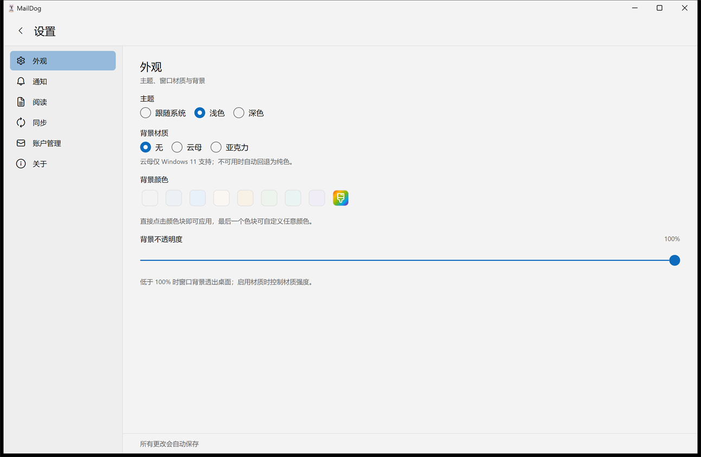

# MailDog

Windows 上把 QQ 邮箱和 Outlook 收进同一个窗口的桌面邮件客户端。看过的信存在本机，断网也能翻；关掉窗口，后台照样收信。

[下载](https://github.com/refout/MailDog/releases/latest) · [官网](https://refout.github.io/MailDog/) · [更新日志](https://refout.github.io/MailDog/changelog.html)


> 截图取自 v0.1.1 的实机运行窗口，里面的邮件是演示数据，不是谁的收件箱。

<details>
<summary>暗色主题和设置页的样子</summary>




</details>

## 现在能做什么

发布版 **v0.2.0** 在 v0.1.2 的写信闭环上补齐了日常使用最硌手的几处：通知合并与免打扰、应用内检查更新、本地来信规则、附件防漏提醒、延迟发送与撤销窗口，以及一个给脚本和助手用的命令行 `maildog`。包仍然直接从 `main` 打。

- **两个邮箱，一个窗口**：QQ 邮箱用授权码登录，Outlook 点一下用浏览器登录，不用填密码。两个邮箱的信在同一份列表里，收件箱、已发送、草稿、存档按邮箱分开列，哪个邮箱有几封没读，名字旁边直接标着。
- **写信闭环**：新写、回复、全部回复、转发；正文只保留原生富文本编辑器（AvaloniaRichEditor），工具栏支持 H1/H2/H3/正文、加粗、斜体、下划线、删除线、项目符号、编号、引用、链接、插入图片与撤销重做；底栏固定「附件」入口，可添加/移除本机附件，单封合计不超过 25 MiB，附件较多时自动换行；设置里可配置邮件签名，新写、回复和转发时自动插到正文下方；草稿可续写并同步到 Drafts；发送成功后按设置保存到已发送。富文本邮件同时生成纯文本回退，出站 HTML 先清洗再交给 SMTP。
- **发件箱可见**：待发送、发送中、失败状态和尝试次数都能看到，失败可手动重试或删除；SMTP 失败按 1/2/5/10/30/60 分钟退避，最多 8 次。
- **邮件管理**：阅读区支持归档、移动到文件夹、删除；文件夹树支持新建、重命名、删除；批量标已读未读、加旗标。
- **找得到旧信**：主题、发件人、预览即时匹配，正文走 SQLite FTS5；图片附件可在阅读区内嵌预览，其他附件下载或用默认程序打开。
- **列表像桌面客户端**：鼠标悬停行右侧出现归档/切换已读/删除；紧凑档两行、标准档三行；主题里的搜索命中词直接高亮；搜索范围可在「当前文件夹 / 全部邮箱」之间切换。
- **同一会话收在一起**：按 `References`/`In-Reply-To` 或规范化主题折叠，行尾显示会话封数，阅读页「会话 N 封」可翻看同会话较早邮件。
- **写信收件人更好填**：To/Cc/Bcc 用 chip 管理，输入时从历史联系人补全，分号、逗号或 Enter 都能提交；发送、草稿和判空都以 chip 为准。
- **本地数据自己管**：设置页能看数据库、日志、附件缓存、发件箱占用并清理；支持创建 ZIP 备份、从备份恢复（下次启动生效）和把单封邮件导出为 `.eml`。
- **账户可维护**：编辑、删除、上移/下移、设为默认发信账户；Outlook 账户可重新授权。
- **新邮件马上提醒**：信到了就弹桌面通知，点一下跳到那封；同一批好几封会合并成一条“收到 N 封新邮件”，免打扰时段与锁屏时只留一句“有新邮件”，订阅文件夹不打扰。连接断了会自己重连，笔记本合盖再打开会补一次同步。
- **来信规则**：设置页「同步」区可按发件人、主题或两者加关键词（包含匹配，忽略大小写），新邮件一到就自动标已读、加旗标或不弹通知；可限定到某个邮箱，命中次数直接显示，规则写得太宽一眼能看出。只对之后收到的邮件生效。
- **发信前提醒、发信后能后悔**：正文提到附件却没带、单附件超 25 MiB、合计超 40 MiB 时先提醒，确认后才发送；默认留 10 秒撤销窗口（可设 0/5/10/30 秒），这段时间邮件停在发件箱，点撤回不会真的发出去。
- **自己检查更新**：关于页与托盘菜单都能检查 GitHub 上的新版本，下载后校验 SHA-256 再静默升级并重启；便携版只提示去下载页。
- **命令行 `maildog`**：`accounts` / `folders` / `list` / `search` / `show` / `attachment` 只读查询，`draft` / `send` / `mark` / `move` 写操作默认只预览，加 `--confirm` 才执行；`maildog schema --json` 供脚本和助手自描述，Engine 没开时会自动拉起。
- **看过的信存在本机**：邮件头、正文都存进本地的 SQLite，断网、邮箱服务器抽风时照样能翻能搜。
- **陌生邮件的排版动不了你的窗口**：HTML 正文只保留安全的那部分，远程图片默认不加载，某封信格式坏了就退回纯文字。
- **关掉窗口也能收信**：右下角托盘里的小图标一直看着邮箱，未读数是图标上的红点。
- **开机就能接着收**：设置页“启动”可以开关登录 Windows 时自动启动；开启后写入当前用户启动项，关闭后移除，不影响账户和邮件数据。
- **只专注邮件**：日历、联系人、待办、记事本模块已移除，左侧只保留账户、文件夹与设置，界面始终停留在邮件列表和阅读区。
- **发信前先看一眼附件**：正文里写了“见附件”却没带文件，或者附件太大时，发送前会拦一下让你确认，不会硬拦。
- **发出去还能反悔**：默认留 10 秒撤销窗口，信先停在发件箱，这段时间点「撤回」就不会真的发出去；设置页可改成 0/5/10/30 秒。
- **下载就能跑**：三个 Native AOT 单文件，不用先装 .NET 运行时，不用另装数据库，也没有要注册的账号。UI 约 51 MB，后台进程约 17 MB，命令行约 5 MB。
- **脚本和助手也能用**：发布包里带 `maildog` 命令行，查账号、列文件夹、搜信、读信、存附件；写信、发送、标已读、移动也支持，但默认只打印预览，加 `--confirm` 才真的动。`--json` 适合自己的脚本，`maildog schema` 让助手自己发现有哪些能力。

## 下载

| 文件 | 说明 |
|---|---|
| `MailDog-0.1.1-win-x64-setup.exe` | 安装包，装完桌面有快捷方式 |
| `MailDog-0.1.1-win-x64.zip` | 64 位便携版，解压双击 `MailDog.UI.exe` |
| `MailDog-0.1.1-win-arm64.zip` | Arm 版便携包 |

都在 [Releases](https://github.com/refout/MailDog/releases/latest) 里。系统要求 Windows 10 1809+ 或 Windows 11；Windows 10 需要先有 [WebView2 Runtime](https://developer.microsoft.com/microsoft-edge/webview2/)（Windows 11 已内置）。

- **QQ 邮箱**：在 QQ 邮箱网页端开启 IMAP/SMTP，生成**授权码**（不是登录密码）填进去。
- **Outlook**：点“使用浏览器登录”，应用已内置 Entra 公共客户端（公共客户端 ID 不属于机密）。想换成自己注册的应用，设环境变量 `MAILDOG_ENTRA_CLIENT_ID`。
- **更新**：关于页与托盘里有「检查更新」，安装版可一键下载、校验 SHA-256 后静默升级并自动重启；便携版只提示去下载页换包。
- **数据放哪**：数据库、日志、原生库都在 `%LOCALAPPDATA%\MailDog\`。

## 命令行

发布目录里有 `MailDog.Cli.exe` 和 `maildog.cmd`；把安装目录加进 PATH 后直接敲 `maildog`：

```powershell
maildog accounts
maildog list --folder inbox --limit 10 --unread
maildog search 发票 --json
maildog show 35211 --max-chars 0
maildog attachment 35211 1 --out D:\tmp
maildog send --account me@example.com --to you@example.com --subject "周报" --text "见附件" --attach D:\周报.pdf
```

写命令（`draft` / `send` / `mark` / `move` / `cancel`）默认只打印预览，确认无误再加 `--confirm` 才真正执行；`send` 会返回撤销窗口，用 `maildog cancel <outboxId>` 撤回；`send` 发送前会查附件，命中提醒时退出码 `6`，确认后加 `--force-send` 强发。`maildog schema` 输出全部命令、开关、输出字段与退出码的 JSON。命令都通过命名管道交给后台 Engine，自己不碰数据库；Engine 没开着会自动拉起来。

## 版本变化

v0.1.0 是只读版（能加邮箱、收信、看信）。v0.1.1 加了关窗后仍收信、托盘与统一收件箱。v0.1.2 补齐写操作并换了新图标与新通知：撰写、回复、全部回复、转发、草稿续写、发件箱重试、已发送副本、自定义 IMAP/SMTP、富文本写信、正文搜索、图片附件预览、本地备份恢复与 `.eml` 导出；通知改用系统 toast，点一下能定位到那封邮件。逐版细节见 [web/changelog.html](web/changelog.html)。

## 开发

### 环境

- .NET SDK 11（锁定 `11.0.100`，见 `src/global.json`）
- Visual Studio Build Tools 2026，勾选 `Microsoft.VisualStudio.Component.VC.Tools.x86.x64` 与 `Microsoft.VisualStudio.Component.Windows11SDK.26100`
- Windows 10 1809+ / Windows 11

### 构建与测试

```powershell
# global.json 在 src 下
cd src
dotnet build MailDog.slnx -c Release
dotnet test MailDog.slnx -c Debug --no-restore
```

### 发布与打包

```powershell
# 发布两个 AOT 单文件（在仓库根执行）
pwsh -File src/build/publish.ps1 -Runtime win-x64

# 版本化压缩包：dist/MailDog-<版本>-win-x64.zip
pwsh -File src/build/package.ps1 -Runtime win-x64

# 打包 + 安装包（需要 Inno Setup 6，可 choco install innosetup）
pwsh -File src/build/package.ps1 -Runtime win-x64 -Installer
```

版本号默认读 `src/Directory.Build.props`，可用 `-Version 1.2.3` 覆盖。推 `v*` 标签会触发 [release 流水线](.github/workflows/release.yml)，构建 win-x64 / win-arm64 压缩包与 x64 安装包并创建 Release。

### 运行

```powershell
# 先起后台，托盘常驻，需要时再打开界面
dist/win-x64/MailDog/MailDog.Engine.exe

# 或者直接开界面（Engine 没跑会自动拉起，两个 exe 必须在同一目录）
dist/win-x64/MailDog/MailDog.UI.exe
```

Engine 支持 `--db <路径>` 换库、`--console` 附着终端输出、`--probe` 自检。界面通过 `MAILDOG_ENGINE_PATH` 找后台，后台通过 `MAILDOG_UI_PATH` 拉起界面。

## 技术构成

- **Engine**：MailKit（IMAP）+ SQLite 索引 + Win32 托盘 + OAuth2 PKCE + 命名管道服务，按需拉起 UI，UI 关闭后继续驻留。
- **UI**：Avalonia 12 + Fluent Design + NativeWebView，关窗即退。

| 维度 | 决策 |
|---|---|
| 目标框架 | .NET 11；Engine 为 `net11.0-windows10.0.19041.0`（通知要用 WinRT 投影），其余为 `net11.0` |
| UI | Avalonia 12.1.6 + `Avalonia.Themes.Fluent` |
| 富文本编辑器 | `AvaloniaRichEditor` 1.3.0（MIT，纯 C#，HTML 导入/导出；无 WebView/TipTap 依赖） |
| WebView | `Avalonia.Controls.WebView` 12.1.2（Windows 用 WebView2），只用于读信 |
| 邮件 | MailKit 5.0.0，不引用 `MimeKit.Cryptography` |
| 存储 | SQLite（`Microsoft.Data.Sqlite`），ADO.NET |
| 认证 | QQ 授权码；Outlook OAuth2 Authorization Code + PKCE（Engine 内自研回环） |
| IPC | 命名管道 + 4 字节长度前缀 + 源生成 JSON |
| 发布 | Native AOT 单文件 × 2，无 .NET 运行时依赖 |
| 平台 | 目前只做 Windows；macOS / Linux 预留抽象 |

## 文档

- [技术方案](docs/PLAN.md)：架构、库选型、IPC 协议、存储、认证、AOT 纪律、里程碑、风险
- [界面设计](docs/UI-DESIGN.md)：Fluent 设计令牌、三栏布局、组件规格、交互与可访问性
- [探针结论](docs/SPIKES.md)：AOT、原生库嵌入、WebView2 与工具链实测记录
- [官网源码](web/)：`index.html` + `assets/site.css`，纯静态，没有构建步骤，Pages 直接发布这个目录

## 仓库结构

```
MailDog/
├── docs/               方案、界面设计、探针结论
├── src/                代码根：MailDog.slnx、global.json、项目、tests、build 脚本
├── web/                官网页面（GitHub Pages 的发布目录）
├── .github/            CI 与 release 工作流
├── .editorconfig
└── README.md
```

## 交付产物

本机构建出来的东西在 `dist/`：

```text
dist/
├── win-x64/
│   ├── MailDog/
│   │   ├── MailDog.Engine.exe
│   │   └── MailDog.UI.exe
│   └── MailDog-<版本>-win-x64.zip
└── MailDog-<版本>-win-x64-setup.exe
```

正式发布的 v0.1.2 在 Release 里：x64 便携包 30.2 MiB、arm64 便携包 28.9 MiB、x64 安装包 21.9 MiB。

- 两个 exe 都是自包含单文件，不需要 .NET 运行时；UI 必须和 Engine 在同一目录才能自动拉起后台。
- SQLite / Skia / HarfBuzz / ANGLE 原生库嵌在 exe 里，首次启动解到 `%LOCALAPPDATA%\MailDog\native\`。
- UI 优先用 ANGLE 渲染，这样云母 / 亚克力材质和透明窗口才生效；加载失败自动回退 Skia 软件渲染。WebView2 有自己的 GPU 进程。
- 关掉 UI 后 `MailDog.UI` 和 `msedgewebview2` 全部退出，Engine 托盘继续驻留。

## 路线图

| 阶段 | 内容 | 状态 |
|---|---|---|
| 0 | 工具链与 AOT 探针 | ✅ 已完成 |
| 1 | Contracts + 源生成序列化 | ✅ 已完成 |
| 2 | Mail + Engine（QQ 只读） | ✅ 已完成 |
| 3 | OAuth2 PKCE（Outlook） | ✅ 已完成 |
| 4 | UI 最小闭环 | ✅ 已完成 |
| 5 | NativeWebView + 净化 + 降级 | ✅ 已完成 |
| 6 | 托盘与进程生命周期闭环 | ✅ 已完成 |
| 7 | 撰写 / 回复 / 转发 / SMTP 发信 | ✅ 已完成（随 v0.1.2 发布） |
| 8 | 写操作、草稿、发件箱、搜索、附件预览、备份恢复 | ✅ 已完成（随 v0.1.2 发布） |
| 9 | 代码签名、自动更新与崩溃上报 | 待证书、发布链路与上报端点 |
| 10 | 真实账户验收、许可证与发布说明 | 待真实邮箱凭据与许可证决定 |
| 11 | 列表悬停/无障碍、搜索范围、会话聚合、收件人 chips 与快捷键 | ✅ 已完成（随 v0.1.2 发布） |
| 12 | 通知链路收口（点击激活、路径自校验、合并与免打扰）、自动更新 | ✅ 已完成（2026-11-24，待发布后真机验证升级；见 `docs/PLAN.md`） |
| 13 | 命令行 `MailDog.Cli`：查账号/文件夹/搜索/读信/取附件，写命令需确认，`--json` 与 `schema` 自描述供脚本与助手调用（MCP 方案已取消；解析层计划迁到 `System.CommandLine`） | 🚧 v0.2.0，见 `docs/PLAN.md` |
| 14 | 本地规则过滤器（发件人/主题匹配 → 标已读/加旗标/静音通知，设置页可增删启停）、延迟发送 + 撤销、附件防漏提醒 | ✅ 已完成（2026-11-24，见 `docs/PLAN.md`） |
| 15 | Windows 集成（mailto / 默认邮件程序 / SendTo / 拖入 .eml / JumpList）、诊断包、账号健康面板 | 🚧 v0.3，见 `docs/PLAN.md` |
| — | 远期不做：HTTP/SOCKS5 代理、S/MIME/PGP、多语言界面 | ⛔ 已记结论，见 `docs/PLAN.md` |


## 已知限制

- v0.1.0 是只读版；写信、回复、草稿、发件箱、正文搜索、附件内嵌预览、备份恢复和 `.eml` 导出从 v0.1.2 起都已包含在发布包里。
- 新邮件靠 IMAP IDLE 实时推送（独立监听连接），服务器不支持或断线时回退到周期轮询。
- Outlook OAuth 与 QQ 真实账户需要真实凭据才能验收，自动化测试只覆盖到协议层。
- 正文搜索只覆盖已缓存到本地的邮件正文；更早、尚未同步的邮件不会进入搜索结果。
- 会话聚合优先用 `References` / `In-Reply-To`，缺失时回退规范化主题；服务器改写过主题或跨账户同主题可能归到同一会话。
- 联系人补全只来自本机已同步邮件的 `from_addr`，不会实时查询服务端通讯录；已发送邮件的收件人暂未纳入候选。
- 草稿续写会恢复收件人、主题、正文和格式；旧 Markdown 草稿首次打开时会转成富文本 HTML，之后只保存富文本，附件仍需重新添加。
- 图片附件预览只支持非 SVG 的 `image/*`，单张上限 8 MiB；其他附件仍走下载或默认程序打开。
- 备份只包含本地数据库，不包含日志、原生缓存和已经落盘的 outbox 附件；恢复需要完全退出 MailDog 后重新启动。
- 账户编辑不改邮箱地址和登录方式；换邮箱需要重新添加账户。QQ / 自定义账户不支持 Outlook 的重新授权按钮。
- Engine 是 `WinExe`，从终端带 `--probe` / `--console` 启动时会附着父控制台。
- 只有 Windows x64 / arm64，没有 32 位，也没有 mac / Linux 版。

## 许可

待定（见 [开放问题](docs/PLAN.md#18-开放问题)）。在定下来之前，仓库里的代码和截图不要直接拿去商用。
